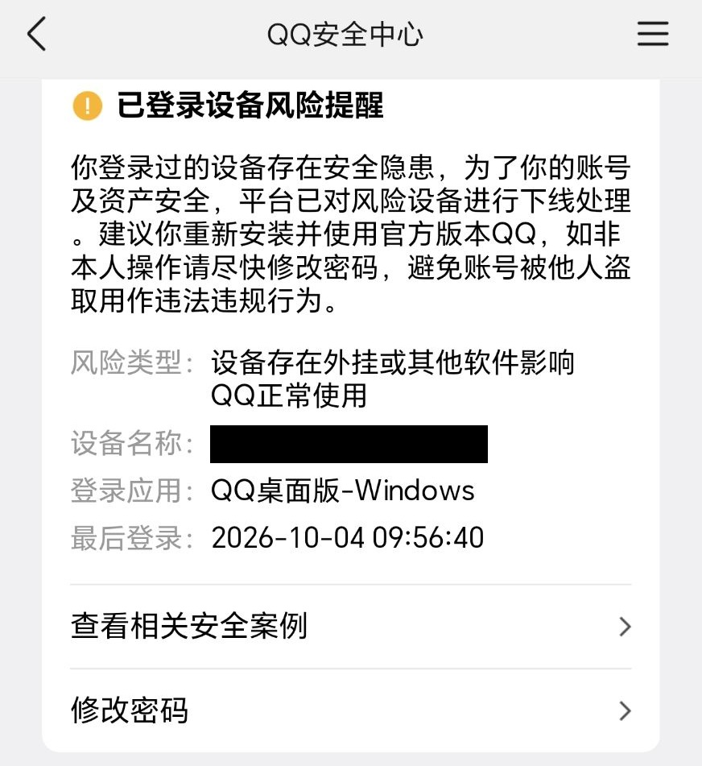

# DataMonitor — 数据提醒小工具

自动盯着设定数据（国内金价），一旦达到设定目标，就通过通信软件（QQ）给你发提醒。

版本 `v2.0.3` ｜ 运行环境 Python 3.13 ｜ 依赖 `requests`、`chinesecalendar（用于获取交易日）`

---

## 它能做什么

- **自动查金价**：直接读取新浪行情（黄金延期 Au(T+D)，单位 元/克），不用开浏览器，速度很快。
- **破新高 / 新低就提醒**：价格刷新当天最高或最低时，通过 QQ 推送。同一方向 5 分钟内只提醒一次，不刷屏。
- **看得懂行情日历**：自动区分交易日、节假日、日盘和夜盘；休市时放慢查询频率，省资源。
- **两种用法**：命令行 或 桌面窗口。窗口右上角有「监控开关」，默认暂停，手动开启。
- **数据自查**：主行情与「伦敦金换算的参考价」做对比，偏差过大时标记为「数据源不一致」。
- **不漏状态**：开关状态存在 `state.json`，程序重启也不会重复提醒。

---

## 开始前准备

1. 电脑装好 **Python 3.13**。
2. 安装两个依赖：

   ```bash
   .venv/Scripts/python.exe -m pip install requests chinesecalendar
   ```

3. 复制配置模板并修改`config.json` （access_token看第4步，别忘了填上你想通知的QQ号及群号）：

   ```bash
   cp config.example.json config.json
   ```

4. 想用 QQ 提醒，需要先部署一个 QQ 机器人协议端（NapCat），并把地址、密钥填进 `config.json`。详细步骤见 [NapCat 部署教程](docs/NapCat部署教程.md)。

---

## 怎么用

**命令行方式**

```bash
.venv/Scripts/python.exe main.py
```

**桌面窗口方式**

```bash
.venv/Scripts/python.exe gui.py
```

> 窗口打开后**默认暂停**，点右上角「监控开关」才开始监控。

**先测一下 QQ 能不能收到消息**

```bash
.venv/Scripts/python.exe notifier.py
```

---

## NapCat 的两个 HTTP 配置

DataMonitor 与 NapCat 之间有两条互相独立的 HTTP 通道，**方向相反，缺一不可**：

| | HTTP 服务器 | HTTP Webhook |
|---|---|---|
| 谁发起连接 | 本程序 → NapCat | NapCat → 本程序 |
| 作用 | **发**消息（告警、查询回复） | **收**消息（识别 `#查询金价`） |
| 谁监听端口 | NapCat | 本程序 |
| 默认端口 | `3000` | `3001` |
| 对应配置 | `notify.qq.api_base`、`access_token` | `query.listen_port` |
| 不开启的后果 | 收不到任何推送 | 发指令无响应 |

两者都在 NapCat WebUI 的「对接应用端」页，点「新增」从右上角菜单里选，是**并列关系**——配好一个不代表另一个生效。

### 一、HTTP 服务器（发消息）

程序通过它把告警与查询结果推到 QQ。

| 字段 | 建议值 |
|---|---|
| 启用 | ✅ 开启 |
| Host / 地址 | `127.0.0.1`（**切勿填 0.0.0.0**，会暴露公网） |
| Port / 端口 | `3000` |
| Token | 一段强随机口令，与 `config.json` 的 `notify.qq.access_token` **完全一致** |
| 消息格式 | `string` 或 `array` 均可 |

对应 `config.json`：

```json
"notify": {
  "qq": {
    "enabled": true,
    "api_base": "http://127.0.0.1:3000",
    "access_token": "与 NapCat 中填的完全一致"
  }
}
```

### 二、HTTP Webhook（收消息）

> 旧版 WebUI 里叫「HTTP 上报」或「HTTP 客户端」，配置文件中的键名是 `httpClients`，三者指同一个东西。

NapCat 通过它把「谁在哪个群说了什么」实时推给本程序，`#查询金价` 才能被识别。

| 字段 | 建议值 | 说明 |
|---|---|---|
| 启用 | ✅ 开启 | 不开启则查询无响应 |
| URL | `http://127.0.0.1:3001` | 与 `query.listen_port` 保持一致 |
| 消息格式 | `string` | `array` 也兼容 |
| `reportSelfMessage`（上报自身消息） | **关闭** | 开启会把机器人自己的回复也当成新消息上报，形成自问自答 |
| Token | 留空 | 需要校验时，与 `query.access_token` 保持一致 |

对应 `config.json`：

```json
"query": {
  "enabled": true,
  "listen_host": "127.0.0.1",
  "listen_port": 3001,
  "commands": ["#查询金价"],
  "access_token": "",
  "reply_cooldown_seconds": 10
}
```

两项都配好后，在 QQ 私聊机器人或把它拉进群发 `#查询金价`，即可收到当前金价与告警阈值。

---

## 常用设置（`config.json`）

| 想改什么 | 改这里 |
|---|---|
| 接收提醒的 QQ 群 | `notify.qq.targets.groups` |
| 协议端地址 / 密钥 | `notify.qq.api_base`、`notify.qq.access_token`（须与 NapCat 里一致） |
| 提醒冷却时间 | `alert.cooldown_seconds`（默认 300 秒） |
| 在 QQ 里查询金价用的指令 | `query.commands` |
| 查询服务监听端口 | `query.listen_port`（须与 NapCat 的「HTTP 上报」URL 一致） |
| 同一人重复查询的最小间隔 | `query.reply_cooldown_seconds`（默认 10 秒，设 `0` 关闭） |
| 各时段查询频率 | `schedule.*` |

其余字段含义见 [DEV_NOTES.md](docs/DEV_NOTES.md)。

---

## 注意事项

- QQ 通道依赖**第三方协议端**，违反 QQ 用户协议，存在封号 / 掉线风险。建议用小号、设强密钥、保持低发送频率。
- 我试过了，虽然没封号，但真的会提示有风险！！！慎用！！！

  

- `config.json` 里的密钥是**明文**，别把这个文件外传。
- 行情接口是**免费公共接口**，请勿高频轮询或用于商业用途。
- 桌面窗口需要有图形界面的电脑；服务器 / 无桌面环境请用 `main.py`。

---

## 相关文档

- [DEV_NOTES.md](docs/DEV_NOTES.md) — 目录结构、数据流、配置全表、设计说明
- [NapCat 部署教程](docs/NapCat部署教程.md) — 协议端部署与常见问题

---

## 许可证

本项目基于 [GNU AGPL-3.0](LICENSE) 许可证开源。

Copyright (C) 2026 [DopeLiu](https://github.com/DopeLiu)

您可以自由地使用、学习和修改本项目，但再分发时须同样采用 AGPL-3.0 协议并保留版权声明；若将修改后的版本部署为网络服务对外提供，也必须向使用者公开其完整源代码。
